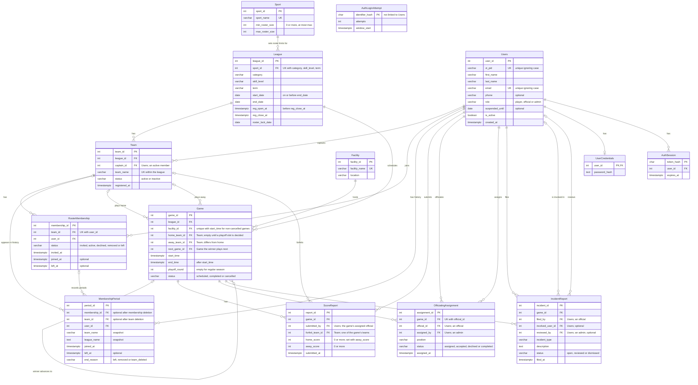

# Hokie Rec ER diagram (Phase III)

Built from `db/schema.sql`, `db/auth.sql`, `db/phase3.sql` and `db/final_features.sql`.

## Rules the diagram can't show

- **Views.** `LeagueView` is a league with its sport's name and roster limits, plus a display name built from the league's columns (e.g. "Coed Soccer, Recreational, Fall 2026"). `LatestScoreReport` is each game's newest score report, the one that counts.
- **Score reports** are never edited; a correction is a new report. Each report holds a result: a forfeit, or both scores.
- **Playoff games:** a game is a playoff game when `playoff_round` is set. Its winner fills a team slot of `next_game_id`. Individual playoff games cannot be rescheduled because feeder order uses start times.
- **Facility slots:** non-cancelled games must have a unique facility and start time; cancelled games leave the slot available.
- **Membership history:** each join creates a period; leave, removal, or team deletion closes it. Migration can recover only the last period still present in each old roster row.
- **Rosters:** a player is active on at most one team per league, and a team's captain is always an active member of it.
- **Game teams** play in the game's league.
- **Deleting:** deleting a team removes its roster rows but retains membership periods with team and league name snapshots. Deleting a game removes its score reports and assignments, but is blocked while it has incident reports. Deleting a user removes their credentials, sessions, and membership history.
